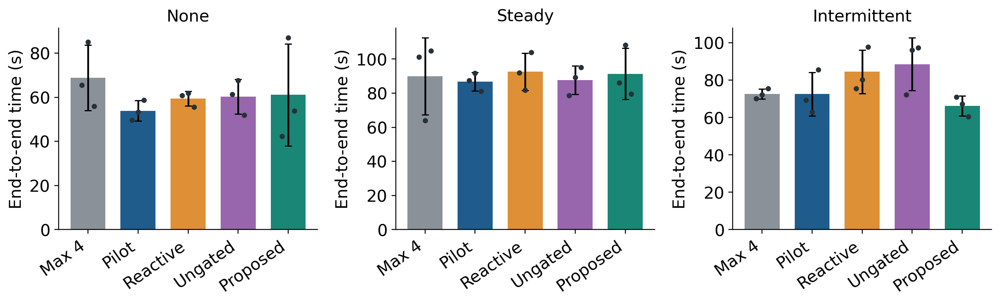

# Overhead Aware CPU Thread Adaptation for Federated Learning

Research implementation and experimental artifacts for **Overhead Aware CPU Thread Adaptation for Federated Learning**, by Mehrmah Khan, Syeda Ayesha Ghaznavi, and Noor Ul Sabah Sami.

This repository investigates whether adapting CPU thread counts during local federated-learning computation can recover the cost of measuring and switching execution settings. It implements matched training probes, an explicit overhead-payback rule, four comparison policies, and an auditable evaluation on Fashion-MNIST.

**Scope:** a single-host CPU execution study with four sequential logical FedAvg clients. Parallelism occurs inside PyTorch tensor kernels; clients do not train concurrently on separate devices. A GPU is not required or used by this implementation.

[Recorded results](results/short/analysis/summary.csv) · [Paired comparisons](results/short/analysis/paired_comparisons.csv) · [Experiment manifest](results/short/manifest.json) · [Dataset instructions](dataset/README.md)

## Research overview

More CPU threads do not necessarily reduce training time: synchronization, scheduling, and competing workloads can offset parallel execution gains. The study keeps the learning workload fixed while evaluating thread-selection policies under no injected load, steady background traffic, and intermittent background traffic.

The implementation provides:

- Matched ABBA/BAAB microprobes that restore identical model, optimizer, and minibatch inputs before each measurement.
- An acceptance rule combining a minimum measured gain with a bounded estimate of whether that gain can repay probing cost.
- A gate-removal ablation using the same probing procedure without the payback condition.
- Paired seeds, fixed real-training work, source/data fingerprints, and per-epoch logs for inspecting the evaluation.

The recorded evaluation contains **45 runs: five policies × three load conditions × three seeds**. Results are mixed: the proposed policy was slower than the pilot-selected fixed baseline under no injected load and steady traffic, and faster under intermittent traffic. **No candidate thread changes were accepted**, so the timing differences do not establish a benefit from thread adaptation or the payback gate.

## Method

The coordinator visits four clients sequentially and performs sample-weighted FedAvg after their local updates. Persistent worker processes are initialized for one, two, and four intra-op threads. Only one worker trains at a time; evaluation uses the one-thread worker. A separate process generates background traffic.

Every fourth local epoch, including the first eligible epoch, the paired controllers compare the current thread count with an adjacent candidate. Four disposable training calls use the same two minibatches in ABBA order, alternating with BAAB at the next probe. Model weights and momentum are restored before each call. Probe updates are discarded before the real training epoch.

Let `uA` and `uB` be mean probe training seconds per example, `N` the client partition size, `H` the smaller of four and the remaining local epochs, and `C` the measured wall time of all four probes, including transfers:

```text
gain              = 1 - uB / uA
predicted_savings = (uA - uB) × N × H
accept candidate  = gain >= 0.05 AND predicted_savings > 1.25 × C
```

The payback rule is a heuristic. Probing cost has already been incurred when the decision is made, and a short probe may not predict future epoch performance.

| Policy | Behavior |
|---|---|
| `max_fixed` | Always uses four threads, the largest tested count. |
| `pilot_fixed` | Uses the fastest count selected by independent no-load pilot measurements. |
| `reactive` | Responds to sustained throughput degradation and tests a lower thread count; can increase after stable epochs. |
| `paired_ungated` | Uses matched probes and a 5% gain threshold without the payback condition. |
| `proposed` | Uses matched probes, the 5% gain threshold, and the overhead-payback condition. |

## Repository structure

```text
overhead-aware-fl/
├── README.md
├── LICENSE
├── .gitignore
├── requirements.txt          # Pinned direct dependencies
├── requirements-lock.txt     # Original experiment environment snapshot
├── setup.sh                  # macOS/Linux environment setup
├── src/
│   ├── core.py               # CNN, data preparation, partitioning, and FedAvg
│   ├── controllers.py        # Reactive and matched-probe policies
│   ├── workers.py            # Persistent workers and background traffic
│   ├── experiment.py         # CLI, pilots, run scheduling, and provenance
│   ├── analyze.py            # Paired comparisons, tables, and plots
│   └── make_figures.py       # Architecture and controller diagrams
├── configs/                  # Smoke, validation, short, and full configurations
├── tests/                    # Correctness tests
├── dataset/                  # README plus locally downloaded data (ignored)
└── results/
    └── short/                # Recorded 45-run evaluation and analysis
```

## Installation

Use **Python 3.10–3.12**, preferably Python 3.12. The pinned environment uses PyTorch 2.2.2 and NumPy 1.26.4; Python 3.13+ is not supported by these pins. The original benchmark ran on an Intel Mac; a new machine produces a new measurement, not an exact reproduction of its timing.

Clone the repository if you do not already have a local copy:

```bash
git clone https://github.com/Noor-Sabah05/overhead-aware-fl.git
cd overhead-aware-fl
```

Run all commands below from the repository root.

### Windows / PowerShell

Create an isolated environment and install dependencies:

```powershell
py -3.12 -m venv .venv
.\.venv\Scripts\python.exe -m pip install --upgrade pip
.\.venv\Scripts\python.exe -m pip install -r requirements.txt
```

These commands invoke the environment directly, so PowerShell activation is unnecessary. In VS Code, choose **Python: Select Interpreter → `.venv\Scripts\python.exe`**.

Check the environment and run correctness tests:

```powershell
.\.venv\Scripts\python.exe src/experiment.py check
.\.venv\Scripts\python.exe -m unittest discover -s tests -v
```

### macOS / Linux

```bash
python3.12 -m venv .venv
source .venv/bin/activate
python -m pip install --upgrade pip
python -m pip install -r requirements.txt
python src/experiment.py check
python -m unittest discover -s tests -v
```

Alternatively, `bash setup.sh` creates the environment, installs dependencies, and prints the environment check. Tests cover partition coverage, weighted aggregation, payback decisions, momentum handling, probe isolation, and incompatible resume rejection.

## Dataset preparation

The study uses [Fashion-MNIST](https://github.com/zalandoresearch/fashion-mnist), with 60,000 training images and 10,000 test images across ten clothing classes. Each image is 28 × 28 pixels. The loader downloads the four official compressed archives, verifies expected MD5 checksums, and records SHA-256 fingerprints.

Prepare the dataset for the reported configuration:

```powershell
.\.venv\Scripts\python.exe src/experiment.py prepare --config configs/short.json
```

This downloads data and builds the cache without training. On macOS/Linux, replace `.\.venv\Scripts\python.exe` with `python` in this and subsequent commands after activating the environment.

The cache defaults to `dataset/`; use `--cache PATH` to choose another location. Downloaded archives, NPZ caches, and generated dataset metadata stay local and are excluded from Git. Only the dataset README is tracked.

The reported configuration selects 10,000 training images using subset seed 12345 and retains the official 10,000-image test set. Normalization uses mean 0.2860 and standard deviation 0.3530. Dirichlet label partitioning uses `alpha = 0.5`; the initial subset is random, not class-stratified.

## Running experiments

### 1. Verify the complete pipeline

Run a small real-data experiment before launching the benchmark:

```powershell
.\.venv\Scripts\python.exe src/experiment.py all --config configs/smoke.json --out results/my-smoke
```

This executes five policies with one seed, one round, one local epoch, and no injected load, then generates analysis. It is a pipeline check, not the reported benchmark.

### 2. Run the reported experimental configuration

```powershell
.\.venv\Scripts\python.exe src/experiment.py all --config configs/short.json --out results/my-short
```

The `all` command prepares data, performs or reuses compatible pilots, executes the shuffled run matrix, and generates analysis. Use a new output directory to preserve the supplied results in `results/short/`.

| Configuration | Training images | Rounds | Local epochs | Purpose |
|---|---:|---:|---:|---|
| `smoke.json` | 1,000 | 1 | 1 | Five-run pipeline check |
| `validation.json` | 3,000 | 3 | 2 | Smaller 45-run diagnostic matrix |
| `short.json` | 10,000 | 10 | 2 | Reported 45-run evaluation |
| `full.json` | 10,000 | 20 | 2 | Optional longer experiment; not the reported results |

Run the optional longer configuration with a separate output directory:

```powershell
.\.venv\Scripts\python.exe src/experiment.py all --config configs/full.json --out results/my-full
```

Runtime depends on the CPU, software environment, and surrounding activity. Keep the machine plugged in and avoid unrelated heavy work during timing measurements.

### 3. Run stages separately, if needed

```powershell
.\.venv\Scripts\python.exe src/experiment.py pilot --config configs/short.json --out results/my-short
.\.venv\Scripts\python.exe src/experiment.py run --config configs/short.json --out results/my-short
.\.venv\Scripts\python.exe src/experiment.py analyze --out results/my-short
```

`pilot` performs calibration only. `run` reuses compatible pilots or performs them if needed, then executes the matrix without final analysis. `analyze` reads existing measurements without retraining.

### 4. Inspect the supplied results without training

Open the tracked [summary](results/short/analysis/summary.csv), [individual measurements](results/short/analysis/per_seed.csv), and [paired comparisons](results/short/analysis/paired_comparisons.csv) directly. To regenerate their analysis files:

```powershell
.\.venv\Scripts\python.exe src/experiment.py analyze --out results/short
```

This rewrites analysis outputs in the specified directory. To generate architecture and controller diagrams:

```powershell
.\.venv\Scripts\python.exe src/make_figures.py
```

The diagram script writes to `results/short/analysis/`.

### Resume and provenance

Repeat the same experiment command to reuse compatible completed runs. Configuration, data, source, and environment identities must match. Interrupted runs are archived with an `.interrupted-<timestamp>` suffix and restart from round zero; this is not mid-epoch checkpoint recovery.

The supplied results retain the original experiment's source hashes. The repository was subsequently reorganized, and model checkpoints are excluded from Git. Use a fresh output directory for new experiments rather than attempting to resume the archived benchmark. Do not modify experiment source files during a run matrix.

## Experimental configuration

| Setting | Reported evaluation |
|---|---|
| Learning algorithm | Sample-weighted FedAvg; all four clients participate |
| Model | Unpadded 3 × 3 convolutions, 1 → 16 → 32; ReLU and max pooling; linear 800 → 10; 12,810 parameters |
| Optimizer | FP32 SGD; learning rate 0.01; momentum 0.9; batch size 64 |
| Momentum lifecycle | Retained between a client's local epochs; reset at each global round |
| Training budget | Ten rounds × two local epochs; 200,000 real examples per run |
| Candidate threads | 1, 2, 4 intra-op threads; inter-op limit one |
| Evaluation / pilot seeds | 0, 1, 2 / 100, 101, 102 |
| Pilot workload | 2,500 examples per measurement; no-load winner selects the fixed baseline |
| Load conditions | None, steady traffic, intermittent traffic (5 seconds on per 10-second period) |
| Background allocation | Three 64 MiB arrays |
| Original hardware | Intel Core i9-9980HK; eight physical / sixteen logical cores; 32 GiB RAM |
| Original environment | macOS 26.5, Python 3.12.14, PyTorch 2.2.2, NumPy 1.26.4 |

The [manifest](results/short/manifest.json) records the executed configuration and environment. `requirements.txt` pins direct dependencies; `requirements-lock.txt` preserves the original environment snapshot rather than guaranteeing identical dependencies on every operating system.

## Recorded findings

Proposed versus pilot-selected fixed threads, averaged across paired seeds:

| Background condition | Mean paired time reduction | Mean accuracy difference |
|---|---:|---:|
| None | −14.64% (slower) | 0.00 percentage points |
| Steady | −5.66% (slower) | 0.00 percentage points |
| Intermittent | +7.91% (faster) | 0.00 percentage points |

Time reduction is computed per seed as `100 × (1 − proposed_time / baseline_time)` and then averaged; it is not computed from the ratio of group means.



The proposed controller accepted zero of 180 candidate probes. No candidate passed the gain threshold and was then rejected solely by the payback gate. Consequently, the experiment does not demonstrate an adaptive-thread speedup or an independent benefit from the gate. The three-seed results are descriptive and do not establish statistical significance. Substantial runtime variation also occurred between the two fixed policies using the same thread count.

### Measurement boundary

Primary runtime begins before model creation and worker startup and ends after checkpoint creation, hashing, and worker shutdown. It includes warm-up, background setup, probing, transfers, real training, aggregation, evaluation, and in-run logging. Dataset preparation, partition generation, independent pilot calibration, and final summary writing are outside this boundary.

Disposable probe examples are counted separately from real SGD work. `controller_s` already includes `probe_s`; adding them double-counts probing cost.

### Output artifacts

| Artifact | Contents |
|---|---|
| `manifest.json` | Configuration, dataset/source hashes, and environment |
| `pilot.json` | Independent calibration measurements |
| `schedule.json` | Reproducibly shuffled job order |
| `runs/<condition>__<method>__seed<N>/` | Summary, partitions, epoch logs, accuracy history, and locally generated checkpoint |
| `analysis/summary.csv` | Per-policy means and sample standard deviations |
| `analysis/per_seed.csv` | Individual run measurements |
| `analysis/paired_comparisons.csv` | Seed-paired runtime and accuracy comparisons |
| `analysis/completeness.json` | Missing-run audit |
| `analysis/*.png`, `analysis/*.svg` | Raster and vector plots |

## Limitations and future work

The evaluation uses one host, one small CNN, three seeds, and a limited thread range. CPU affinity, power settings, and thermals were not controlled. No hardware performance counters were collected, so timing cannot uniquely identify DRAM contention. The workload does not measure network communication, simultaneous clients, energy savings, differential privacy, or secure aggregation.

Future experiments can add repeated timings per seed, controlled CPU placement, hardware counters, randomized interference phase offsets, larger models, and additional machines. A pre-probe cost decision could avoid measurement overhead before it is incurred. Deployment across separate devices requires a distinct distributed evaluation.

## Troubleshooting

- **Python 3.12 is unavailable:** install a supported interpreter before creating the environment; do not use Python 3.13+ with these dependency pins.
- **VS Code cannot resolve `torch`:** select the repository's `.venv` interpreter and install `requirements.txt` in that environment.
- **Dataset download fails:** check network access to `raw.githubusercontent.com`, then repeat `prepare`. Do not bypass checksum validation.
- **Resume reports an identity mismatch:** choose a fresh `--out` directory for changed code, data, configuration, or environment.
- **Results differ from the paper:** inspect your manifest and per-seed measurements; timing and learning outcomes can vary across hosts and runtime conditions.

## Citation

To reference this implementation, use the repository citation below. It does not imply a peer-reviewed publication or DOI.

```bibtex
@misc{khan2026overheadawarefl,
  author = {Khan, Mehrmah and Ghaznavi, Syeda Ayesha and Sami, Noor Ul Sabah},
  title = {Overhead Aware CPU Thread Adaptation for Federated Learning},
  year = {2026},
  howpublished = {Research software repository},
  url = {https://github.com/Noor-Sabah05/overhead-aware-fl}
}
```

When reporting a reproduction, also record the commit identifier, configuration, and generated manifest. The accompanying research report provides the literature discussion and full experimental interpretation.

## License

Repository code is distributed under the [MIT License](LICENSE). Fashion-MNIST is obtained separately from its original source; consult its repository for dataset licensing and attribution.
